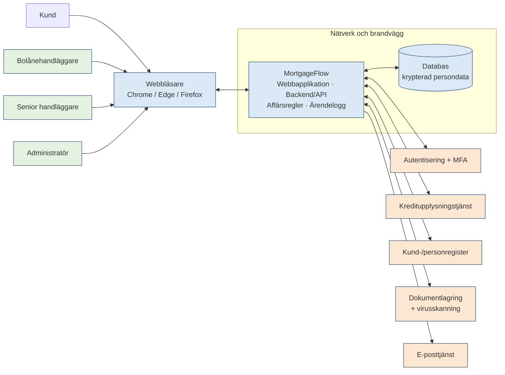

# Teststrategi för MortgageFlow

**NordFinance**
Projekt MortgageFlow
Teststrategi för MortgageFlow
**Version 1.0**

| **Fält** | **Ange** |
| --- | --- |
| Ämne | MortgageFlow – internt bolånesystem för NordFinance |
| Författare | Grupp 2 |
| Organisation | NordFinance |
| Version | 1.0 |

## Dokumenthistorik

| **Datum** | **Version** | **Beskrivning** | **Författare** |
| --- | --- | --- | --- |
| 2026-10-15 | 1.0 | Första version av teststrategin (Del 1) | Grupp 2 |
|  |  |  |  |

# Innehållsförteckning

- [1 Teststrategi för MortgageFlow](#1--teststrategi-för-mortgageflow)
  - [1.1 Kortfattad beskrivning](#11--kortfattad-beskrivning)
  - [1.2 Termer och förkortningar](#12--termer-och-förkortningar)
  - [1.3 Hänvisningar till andra dokument](#13--hänvisningar-till-andra-dokument)
  - [1.4 Öppna frågor](#14--öppna-frågor)
- [2 Testnivåer](#2--testnivåer)
  - [2.1 Komponenttest](#21--komponenttest)
  - [2.2 Systemintegrationstest (SIT)](#22--systemintegrationstest-sit)
  - [2.3 Systemtest](#23--systemtest)
  - [2.4 End-to-end-test (E2E)](#24--end-to-end-test-e2e)
  - [2.5 Acceptanstest](#25--acceptanstest)
  - [2.6 Regressionstest och omtest](#26--regressionstest-och-omtest)
- [3 Testmiljö](#3--testmiljö)
- [4 Testobjekt](#4--testobjekt)
  - [4.1 Inloggning och säkerhet](#41--inloggning-och-säkerhet)
  - [4.2 Ansökan och ärendehantering](#42--ansökan-och-ärendehantering)
  - [4.3 Kreditkontroll och affärsregler](#43--kreditkontroll-och-affärsregler)
  - [4.4 Dokument, beslut och kundkommunikation](#44--dokument-beslut-och-kundkommunikation)
  - [4.5 Behörighet, loggning och administration](#45--behörighet-loggning-och-administration)
  - [4.6 Integrationer](#46--integrationer)
  - [4.7 Icke-funktionella krav](#47--icke-funktionella-krav)

# 1  Teststrategi för MortgageFlow

Teststrategin beskriver hur MortgageFlow testas och fungerar som gemensamt kommunikationsunderlag för testteamet, utvecklingsteamen, Product Owner (PO), verksamhetsrepresentanterna, säkerhetsspecialisten, DevOps och projektledningen.

## 1.1  Kortfattad beskrivning

Teststrategin beskriver hur MortgageFlow normalt testas. MortgageFlow är NordFinance nya interna bolånesystem. Det används av bankens bolånehandläggare för att ta emot bolåneansökningar, kontrollera kunduppgifter, genomföra kreditbedömningar, hantera dokumentation, godkänna eller avslå bolån och kommunicera beslut till kunden.

Systemet har tre användarroller: bolånehandläggare, senior handläggare och administratör. MortgageFlow är beroende av en extern kreditupplysningstjänst, kund-/personregister, e-posttjänst, MFA och autentisering, dokumentlagring med virusskanning, databas samt nätverk och brandvägg.

**Varför testningen är viktig.** Systemet är verksamhetskritiskt. Fel kan leda till ekonomiska förluster, felaktiga kreditbedömningar, säkerhetsproblem, GDPR-incidenter och missnöjda kunder.

**Riskbaserat angreppssätt.** Testningen prioriteras utifrån risk, där risk = sannolikhet (S) × konsekvens (K) (skala 1–3). Ju högre risk, desto tidigare och djupare testning. Högst prioritet har:

- kreditbedömning och affärsregler (skuldkvot, belåningsgrad, riskklass),
- dubbelgodkännande av lån över 5 miljoner SEK,
- behörighet, säkerhet och skydd av persondata,
- integrationen mot kreditupplysningstjänsten,
- loggning av statusändringar och beslut (spårbarhet).

Identifierade produktrisker:

| **ID** | **Risk** | **S** | **K** | **Risk** | **Huvudsaklig teståtgärd** |
| --- | --- | --- | --- | --- | --- |
| R1 | Felaktig kreditbedömning: fel skuldkvot, belåningsgrad eller riskklass | 2 | 3 | 6 Hög | Beslutstabeller och gränsvärden i systemtest, E2E |
| R2 | Lån över 5 MSEK godkänns utan senior handläggare | 2 | 3 | 6 Hög | Gränsvärden, behörighetstest, E2E |
| R3 | Användare ser eller ändrar ärenden utan behörighet | 2 | 3 | 6 Hög | Behörighetsmatris i UI och API |
| R4 | Persondata exponeras eller lagras okrypterad (GDPR) | 2 | 3 | 6 Hög | Säkerhetstest med säkerhetsspecialist |
| R5 | Kreditupplysningstjänsten svarar fel eller inte alls | 3 | 2 | 6 Hög | SIT med negativa fall och timeout |
| R6 | Inloggning, MFA, kontolåsning eller utloggning fungerar inte | 2 | 3 | 6 Hög | Systemtest, säkerhetstest |
| R7 | Statusändringar och beslut loggas inte | 2 | 2 | 4 Medel | Systemtest av ärendelogg |
| R8 | Skadliga eller för stora filer kan laddas upp | 2 | 2 | 4 Medel | Systemtest med testfil för virusskanning |
| R9 | Svarstid över 2 s eller instabilitet vid 500 användare | 2 | 2 | 4 Medel | Prestandatest |
| R10 | Kunden får fel eller ingen e-postbekräftelse | 2 | 2 | 4 Medel | SIT, E2E |

*S = sannolikhet, K = konsekvens (1 = låg, 3 = hög). Risk 6–9 = Hög, 3–4 = Medel, 1–2 = Låg.*

**Testansvar och avgränsning.** Testteamet ansvarar för att MortgageFlow och dess integrationer fungerar. De beroende systemens interna logik (till exempel hur kreditupplysningstjänsten räknar fram kreditvärdighet) testas inte, men MortgageFlows hantering av deras svar, fel och uteblivna svar ingår.

Vid varje release genomförs testplanering. Testplaneringen dokumenteras i en testplan som kompletterar teststrategin och beskriver eventuella avsteg från strategin.

## 1.2  Termer och förkortningar

| **Term** | **Förklaring** |
| --- | --- |
| Felrapport | Ett registrerat ärende för ett identifierat fel. |
| Testverktyg | Verktyg som används för krav-, test- och felhantering. |
| Ärende | En bolåneansökan i MortgageFlow med tillhörande uppgifter, dokument, status och logg. |
| Skuldkvot | Kundens totala skulder i förhållande till årsinkomsten. Över 6 ger hög risk. |
| Belåningsgrad | Lånebeloppet i förhållande till objektvärdet. Över 85 % ger varning. |
| Riskklass | Systemets bedömning av ärendets risknivå utifrån affärsreglerna. |
| Dubbelgodkännande | Lån över 5 MSEK godkänns först av handläggare och sedan av senior handläggare. |
| MFA | Multifaktorautentisering – inloggning med mer än ett bevis på identitet. |
| SIT | Systemintegrationstest – test av att MortgageFlow och beroende system fungerar tillsammans. |
| E2E | End-to-end-test – test av ett helt affärsflöde från ny ansökan till beslut. |
| UAT | Acceptanstest som genomförs av verksamheten i ACC. |
| DEV / SYS / ACC / PROD | Utvecklings-, system-, acceptanstest- och produktionsmiljö. |
| Stub / mock | Simulerat system som används när det riktiga systemet inte finns i testmiljön. |
| Smoke test | Kort test efter deployment som visar att miljön är redo för vidare test. |
| Omtest (retest) | Test som visar att en rättad defekt är löst. |
| Regressionstest | Test som visar att tidigare fungerande funktionalitet inte har påverkats av ändringar. |
| Severity / Priority | Hur allvarligt ett fel är / hur snabbt det ska åtgärdas. |
| Entry / Exit criteria | Villkor för att en testnivå får starta respektive anses avslutad. |
| Go/No-Go | Beslutstillfälle om releasen ska produktionssättas. |
| Kvarstående risk | Risk som finns kvar efter genomförd testning (residual risk). |
| GDPR | EU:s dataskyddsförordning. |
| PO | Product Owner. |

## 1.3  Hänvisningar till andra dokument

| **Dokument** | **Beskrivning / sökväg** |
| --- | --- |
| Testplan | Testplan för MortgageFlow, version 1.0. \<Länk eller sökväg> |
| Kravunderlag | Slutprojekt – Teststrategi och planering, Case: MortgageFlow (funktionella och icke-funktionella krav). \<Länk> |
| Riskregister | Produkt- och projektrisker med bedömning och åtgärd. \<Länk> |
| Behörighetsmatris | Vilka roller får se och göra vad i MortgageFlow. \<Länk> |
| Fil med testdata | Syntetiska testpersoner, inkomster, objektvärden, kreditupplysningssvar och testfiler. \<Länk> |
| SQL-skript | Skript för att skapa och återställa testdata i SYS och ACC. \<Länk> |
| Felhanteringsprocess | Defekters livscykel, severity, priority och triage. \<Länk> |

## 1.4  Öppna frågor

Följande frågor påverkar strategin. Måldatum anges som projektvecka (vecka 1–12 i projektets tidplan).

| **Öppen fråga** | **Ansvarig** | **Måldatum** | **Status** |
| --- | --- | --- | --- |
| Gäller gränserna exakt? Är skuldkvot 6,0 hög risk, belåningsgrad 85,0 % varning och lån på exakt 5 000 000 SEK föremål för dubbelgodkännande? | Product Owner | Vecka 1 | Öppen |
| Hur räknas riskklass fram och hur många riskklasser finns? | Product Owner / verksamhet | Vecka 1 | Öppen |
| Vilka beslut får senior handläggare överstyra, och ska motivering krävas och loggas? | Product Owner | Vecka 1 | Öppen |
| Räknas fem felaktiga inloggningsförsök i följd, och nollställs räknaren efter lyckad inloggning? | Product Owner / säkerhetsspecialist | Vecka 1 | Öppen |
| Hur ska systemet bete sig när kreditupplysningstjänsten inte svarar? | Product Owner / arkitekt | Vecka 2 | Öppen |
| Finns testmiljö hos kreditupplysningstjänsten med styrbara testsvar, eller behövs en stub? | Representant kreditupplysningstjänsten | Vecka 2 | Öppen |
| Hur sätts status Utbetald – manuellt eller via integration med annat system? | Product Owner | Vecka 2 | Öppen |
| Får maskerad produktionsdata användas i ACC, eller endast syntetisk data? | Projektledare / dataskyddsansvarig | Vecka 2 | Öppen |
| Vad menas med ”normal belastning”, och kan prestandatest göras i SYS? | Product Owner / DevOps | Vecka 2 | Öppen |
| Vem genomför säkerhetstest och ingår penetrationstest? | Säkerhetsspecialist | Vecka 2 | Öppen |
| Vilka versioner av Chrome, Edge och Firefox ska stödjas? | Product Owner | Vecka 2 | Öppen |
| Vem deltar i Go/No-Go och vem fattar beslutet? | Projektledare | Vecka 3 | Öppen |

# 2  Testnivåer

MortgageFlow testas på sex nivåer. Varje nivå har ett eget fokus så att vi undviker luckor och onödig dubblering. Testteamet består av fyra testare med olika kompetens, vilket styr vem som ansvarar för vilken nivå.

| **Testnivå** | **Utförs av** | **Miljö** | **Fokus** |
| --- | --- | --- | --- |
| Enhettest | Utvecklare i de tre utvecklingsteamen | DEV | Logik och regler i en komponent |
| SIT | Testare A + utvecklare | SYS | Att MortgageFlow och beroende system fungerar tillsammans |
| Systemtest | Testare B (funktion), Testare D (behörighet), Testare A (API, prestanda), säkerhetsspecialist | SYS | Att hela systemet uppfyller funktionella och icke-funktionella krav |
| E2E | Testare B och C | SYS | Hela affärsflöden från ny ansökan till beslut |
| Acceptanstest | Verksamhetsrepresentanter med stöd av Testare C | ACC | Att systemet stödjer handläggarnas arbete |
| Regression och omtest | Testare D med stöd av övriga | SYS | Att rättningar fungerar och inget annat har gått sönder |

## 2.1  Enhettest

**Utförs av:** Utvecklare i de tre utvecklingsteamen.

**Syfte och mål:** Verifiera att enskilda komponenter och affärsregler fungerar isolerat, till exempel:

- validering av personnummer (kontrollsiffra), obligatoriska fält och inkomst,
- kontrollen att lånebeloppet inte överstiger objektvärdet minus kontantinsatsen,
- beräkning av skuldkvot, belåningsgrad och riskklass,
- tillåtna statusövergångar i ärendet.

**Mottagare av resultat:** Utvecklingsteamet. Resultatet syns i bygget.

**Omfattning och avgränsning:** Automatiserade enhetstester som körs vid varje bygge i DEV. Beroende system ersätts med mockar. Integrationer och användargränssnitt ingår inte.

## 2.2  Systemintegrationstest (SIT)

**Utförs av:** Testare A tillsammans med utvecklare, DevOps och representanten från kreditupplysningstjänsten.

**Syfte och mål:** Verifiera att MortgageFlow kommunicerar korrekt med kreditupplysningstjänsten, kund-/personregistret, e-posttjänsten, MFA/autentisering och dokumentlagringen. Varje integration testas med:

- korrekta svar och korrekt tolkning av data (kreditvärdighet, betalningsanmärkningar, skuldsaldo, taxerad inkomst),
- felaktiga eller ofullständiga svar,
- timeout och system som inte svarar,
- upprepade anrop,
- loggning och spårbarhet.

**Mottagare av resultat:** Testledare och utvecklingsteamen.

**Omfattning och avgränsning:** API- och integrationstester i SYS, delvis automatiserade. Stub används om en beroende tjänst saknar testmiljö, men det riktiga beteendet ska verifieras innan SIT avslutas. De beroende systemens interna logik ingår inte.

## 2.3  Systemtest

**Utförs av:** Testare B (funktionellt), Testare D (behörighet), Testare A (API och prestanda) och säkerhetsspecialisten (säkerhet).

**Syfte och mål:** Verifiera att MortgageFlow som helhet uppfyller de funktionella och icke-funktionella kraven.

- Funktionella tester per kravområde: inloggning, ansökan, ärendestatus, kreditkontroll, stora lån, dokument och beslut.
- Behörighetstester per roll, både i användargränssnittet och direkt mot API:et.
- Säkerhetstester: MFA, kontolåsning, automatisk utloggning, kryptering av persondata.
- Prestandatest: svarstid inom 2 sekunder och minst 500 samtidiga användare.
- Kompatibilitetstest i Chrome, Edge och Firefox.

**Mottagare av resultat:** Testledare, Product Owner och projektledare.

**Omfattning och avgränsning:** Genomförs i SYS. Testfallen designas med gränsvärdesanalys, beslutstabeller, tillståndsbaserad testning och utforskande testning.

## 2.4  End-to-end-test (E2E)

**Utförs av:** Testare B, med verksamhetskunskap och testdata från Testare C.

**Syfte och mål:** Verifiera att hela affärsflöden fungerar genom MortgageFlow och alla beroende system. De kritiska flödena är:

1. **Standardärende:** ny ansökan → granskning → kreditkontroll → låg risk → godkänd → e-postbekräftelse.
2. **Komplettering:** instabil anställning och låg inkomst → komplettering krävs → dokument laddas upp → ny granskning → beslut.
3. **Stort lån:** lån över 5 MSEK → handläggaren godkänner → senior handläggare godkänner → godkänd.
4. **Hög risk:** aktiv betalningsanmärkning → hög risk → senior handläggare → avslag med registrerad orsak.
5. **Tjänsten svarar inte:** kreditupplysningen uteblir → ärendet får inget beslut på ofullständiga uppgifter.

**Mottagare av resultat:** Testledare, Product Owner och projektledare.

**Omfattning och avgränsning:** Genomförs i SYS när SIT är avslutat. Testdata måste fungera genom hela kedjan. Varje flöde verifieras även i ärendeloggen.

## 2.5  Acceptanstest

**Utförs av:** Verksamhetsrepresentanter (bolånehandläggare och senior handläggare), med stöd av Testare C.

**Syfte och mål:** Bekräfta att MortgageFlow stödjer handläggarnas verkliga arbetssätt och att verksamheten kan godkänna systemet för produktion.

**Mottagare av resultat:** Product Owner, som underlag för Go/No-Go.

**Omfattning och avgränsning:** Scenariobaserade tester av verkliga ärendetyper i ACC. Godkännandet dokumenteras. Verksamheten testar inte tekniska detaljer som redan verifierats i systemtest.

## 2.6  Regressionstest och omtest

**Utförs av:** Testare D (automatisering), med stöd av den testare som hittade respektive fel.

**Syfte och mål:** Omtest visar att en rättad defekt är löst. Regression visar att rättningar och nya leveranser inte har förstört något som fungerade tidigare.

**Mottagare av resultat:** Testledare och utvecklingsteamen.

**Omfattning och avgränsning:** Smoke test körs efter varje deployment till SYS och ACC. Regressionen är riskbaserad: P1 körs alltid, P2 om tid finns, P3 kan utelämnas. Stabila och affärskritiska tester – inloggning, affärsregler för kreditkontroll och behörighet – automatiseras först. Det som inte körs redovisas som kvarstående risk inför Go/No-Go.

**Defekthantering.** Fel registreras i testverktyget och följer livscykeln New → Analysis → In Progress → Ready for Retest → Closed. Severity anger hur allvarligt felet är och priority hur snabbt det ska åtgärdas. Testledaren leder regelbunden defect triage. Fel som ligger i ett beroende system rapporteras till systemets ägare.

**Uppföljning och rapportering.** Testledaren följer Planned vs Executed, Passed, Failed, Blocked, Not Run, öppna defekter per severity och risktäckning. Siffrorna analyseras och rapporteras tillsammans med kvarstående risk och rekommenderad åtgärd. Inför Go/No-Go ger testledaren en rekommendation – Go, Conditional Go eller No-Go – och Product Owner fattar beslutet tillsammans med projektledaren.

# 3  Testmiljö

Projektet använder miljökedjan DEV → SYS → ACC → PROD. En miljö är redo för test först när rätt version är installerad, konfigurationen är rätt, integrationerna är anslutna, testarna har åtkomst och behörighet och rätt testdata finns. DevOps ansvarar för miljöerna och testledaren för att följa upp miljöbehov och blockerare.

| **Miljö** | **Syfte** | **Viktiga skillnader mot produktion** |
| --- | --- | --- |
| DEV | Utveckling och komponenttest | Beroende system ersätts av mockar. Begränsad data. Ändras ofta och är inte stabil för test. |
| SYS | SIT, systemtest, API-test, E2E, regression och omtest | Delas av alla testaktiviteter och tre utvecklingsteam – kräver planering av deployment och testdata. Kopplad till testversioner av beroende system eller stubbar. Mindre kapacitet än produktion, vilket påverkar prestandatestet. |
| ACC | Verksamhetens acceptanstest | Ska vara så lik produktion som möjligt i version, konfiguration och integrationer. Endast syntetisk (eller beslutad maskerad) data. Ändras bara via releaseprocessen. |
| PROD | Produktion (ingen testmiljö) | Verkliga kunder och persondata. Endast smoke test efter produktionssättning. |

Beroende system i testmiljöerna:

| **Beroende system** | **I SYS / ACC** | **Skillnad mot produktion** |
| --- | --- | --- |
| Kreditupplysningstjänst | Testmiljö hos leverantören eller stub (öppen fråga) | Förutbestämda svar per testpersonnummer. En stub fångar inte alla verkliga felkoder och svarstider. |
| Kund-/personregister | Testinstans | Innehåller endast testpersoner. |
| E-posttjänst | Testinstans | Utskick fångas upp och når inga riktiga kunder. |
| MFA och autentisering | Testkonfiguration | Testkonton och testenheter för MFA per roll. |
| Dokumentlagring och virusskanning | Testinstans | Virusskanning verifieras med en ofarlig standardtestfil. |
| Databas | Separat testdatabas | Krypterad på samma sätt som produktion. Återställs med SQL-skript. |

**Testdata.** Testdata planeras innan teststart och tas fram under vecka 3 av Testare C. Endast syntetiska testpersoner med testpersonnummer används, eftersom riktiga kunders person- och kreditdata inte får användas utan beslut (se 1.4). Testdatan ska täcka gränsvärden och kombinationer i affärsreglerna, till exempel skuldkvot under, på och över 6, belåningsgrad under, på och över 85 %, lån under, på och över 5 MSEK, aktiva betalningsanmärkningar, instabil anställning med låg inkomst samt filer på och över 10 MB. För E2E måste samma testperson fungera i alla beroende system.

**Skiss över system och integrationer**

*Blått = MortgageFlow, testas fullt ut. Orange = beroende system, endast integrationen testas.*

# 4  Testobjekt

Testobjekten beskrivs på övergripande nivå. Prioriteten (Hög/Medel/Låg) styr testdjupet och kommer från riskbedömningen i 1.1.

## 4.1  Inloggning och säkerhet

| **Testobjekt / område** | **Vad ska verifieras?** | **Kommentar / avgränsning** |
| --- | --- | --- |
| Inloggning med MFA | Användarnamn, lösenord och MFA krävs för alla roller. Felaktigt lösenord eller MFA ger ingen åtkomst. | Hög (R6) |
| Kontolåsning | Kontot låses efter fem felaktiga försök och kan låsas upp av administratör. Gränsvärden: 4, 5 och 6 försök. | Hög (R6). Räkning i följd är öppen fråga. |
| Automatisk utloggning | Användaren loggas ut efter 10 minuters inaktivitet, men inte före. | Hög (R6) |

## 4.2  Ansökan och ärendehantering

| **Testobjekt / område** | **Vad ska verifieras?** | **Kommentar / avgränsning** |
| --- | --- | --- |
| Registrering av ansökan | Alla fält registreras. Personnummer, obligatoriska fält och inkomst valideras. | Hög |
| Kontroll av lånebelopp | Lånebeloppet får inte överstiga objektvärdet minus kontantinsatsen. Gränsvärden: under, lika med och över. | Hög (R1) |
| Ärendestatus | Tillåtna övergångar Ny → Under granskning → Komplettering krävs → Kreditkontroll pågår → Godkänd/Avslagen → Utbetald. Otillåtna övergångar stoppas. | Hög. Tillståndsbaserad testning. |
| Statusändringar | Endast behöriga roller kan ändra status. Varje ändring loggas. | Hög (R3, R7) |

## 4.3  Kreditkontroll och affärsregler

| **Testobjekt / område** | **Vad ska verifieras?** | **Kommentar / avgränsning** |
| --- | --- | --- |
| Hämtning av kreditupplysning | Kreditvärdighet, betalningsanmärkningar, skuldsaldo och taxerad inkomst hämtas och visas korrekt. | Hög (R5) |
| Beräkningar | Skuldkvot, belåningsgrad och riskklass beräknas korrekt. | Hög (R1) |
| Affärsregler | Skuldkvot över 6 → hög risk. Aktiv betalningsanmärkning → hög risk och senior handläggare. Belåningsgrad över 85 % → varning. Instabil anställning och låg inkomst → kompletterande dokumentation. | Hög (R1). Beslutstabeller och gränsvärden. |
| Stora lån | Lån över 5 MSEK kräver godkännande av både bolånehandläggare och senior handläggare, i den ordningen. | Hög (R2) |

## 4.4  Dokument, beslut och kundkommunikation

| **Testobjekt / område** | **Vad ska verifieras?** | **Kommentar / avgränsning** |
| --- | --- | --- |
| Dokumentuppladdning | PDF, JPG och PNG accepteras, högst 10 MB. Andra filtyper och större filer avvisas. Filer virusskannas, versionshanteras och uppladdningen loggas. | Medel (R8) |
| Beslut | Handläggaren kan godkänna, avslå eller begära komplettering. Avslagsorsak är obligatorisk. Beslut loggas. | Hög |
| E-postbekräftelse | Kunden får automatiskt e-post vid godkännande, med rätt innehåll och till rätt mottagare. | Medel (R10) |

## 4.5  Behörighet, loggning och administration

| **Testobjekt / område** | **Vad ska verifieras?** | **Kommentar / avgränsning** |
| --- | --- | --- |
| Behörighet per roll | Varje roll ser och gör endast det rollen får. Kontrolleras både i användargränssnittet och mot API:et. | Hög (R3) |
| Handläggare | Kan godkänna lån under 5 MSEK, se rapporter och statistik. |  |
| Senior handläggare | Kan godkänna lån över 5 MSEK, överstyra vissa beslut och se rapporter och statistik. | Hög. Vilka beslut som får överstyras är öppen fråga. |
| Administratör | Hanterar användare, tilldelar roller och konfigurerar systeminställningar. | Hög |
| Ärendelogg | Vem som ändrat ett ärende och när loggas för statusändringar, beslut och uppladdningar. | Hög (R7) |

## 4.6  Integrationer

| **Testobjekt / område** | **Vad ska verifieras?** | **Kommentar / avgränsning** |
| --- | --- | --- |
| MortgageFlow ↔ kreditupplysningstjänst | Korrekt anrop och tolkning av svar, felaktiga svar, timeout. | Hög (R5) |
| MortgageFlow ↔ kund-/personregister | Rätt kunduppgifter hämtas för personnumret. | Medel |
| MortgageFlow ↔ MFA/autentisering | Inloggning och felhantering. | Hög |
| MortgageFlow ↔ dokumentlagring | Lagring, versionshantering och virusskanning. | Medel |
| MortgageFlow → e-posttjänst | Utskick vid godkännande, hantering när tjänsten inte svarar. | Medel |

## 4.7  Icke-funktionella krav

| **Testobjekt / område** | **Vad ska verifieras?** | **Kommentar / avgränsning** |
| --- | --- | --- |
| Prestanda | Svarstid inom 2 sekunder vid normal belastning och stabil drift med minst 500 samtidiga användare. | Medel (R9). ”Normal belastning” behöver definieras. |
| Säkerhet och dataskydd | Persondata krypteras. Inga persondata i loggar eller felmeddelanden. | Hög (R4). Genomförs med säkerhetsspecialisten. |
| Webbläsare | Funktionerna fungerar i Chrome, Edge och Firefox. | Medel. Versioner är öppen fråga. |

